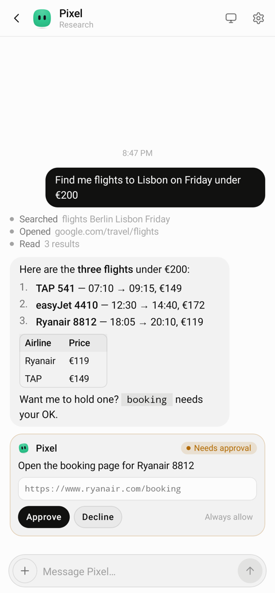
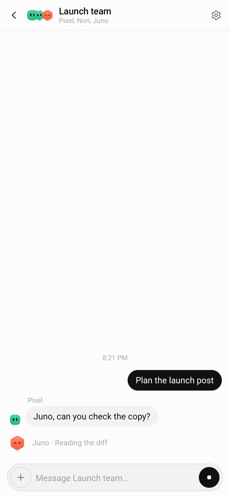
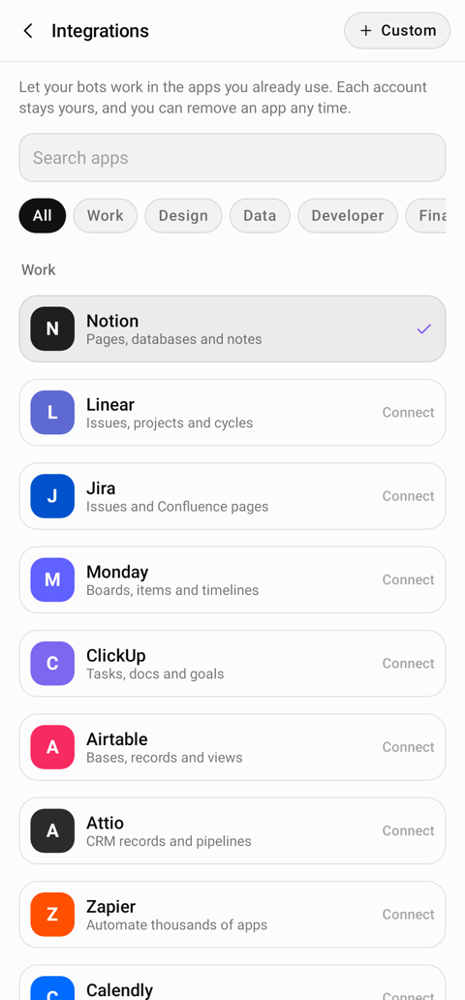

<p align="center">
  
</p>

<h1 align="center">gbot</h1>

<p align="center"><strong>Cute, persistent AI teammates that run entirely on your own machine.</strong></p>

<p align="center">
  <a href="https://github.com/ganeshdipdumbare/gbot/actions/workflows/ci.yml"></a>
  
  
  
  
</p>

<p align="center">
  <a href="https://gbot-ai.vercel.app/">Website</a> ·
  <a href="#quick-start">Quick start</a> ·
  <a href="#features">Features</a> ·
  <a href="#configuration">Configuration</a> ·
  <a href="#security">Security</a>
</p>

Each bot is a simple, expressive character with its own name, memory, one
continuous chat, and its own computer. Bots remember what you tell them,
show what they're doing through their eyes and motion (thinking, working,
needs you, stuck, done), and keep working while you keep chatting.

---

## Screenshots

<table>
  <tr>
    <th>New bot</th>
    <th>Chat and approvals</th>
    <th>Group chat</th>
    <th>Integrations</th>
  </tr>
  <tr>
    <td></td>
    <td></td>
    <td></td>
    <td></td>
  </tr>
</table>

---

## Features

### Teammates, not tabs

- **A main bot.** Every account starts on **gbot**, the bot that looks after
  the others: ask it for a teammate and it hatches one, retitles one, changes
  a model or archives one, each behind an approval card. It's first in the
  roster and can't be deleted. The same bot, with the same powers, on the
  phone, the web and macOS.
- **Memory that lasts.** Before a long chat outgrows the model, a rolling
  summary keeps the facts that matter. A bot can also search its own history
  for anything older.
- **Approvals and questions.** Bots ask before risky steps with a card in the
  chat (Ask, Auto or Never ask, plus allow/block lists). They ask you
  questions the same way. Cards never block the chat.
- **A queue that survives restarts.** Messages run in order; pause, resume
  or cancel any one. If the server restarts, what was waiting runs next
  instead of vanishing.

### Its own computer

A private Linux desktop (browser, terminal, files, and an Activity log of
everything the bot runs) in its own microVM via
[microsandbox](https://github.com/superradcompany/microsandbox), or a Docker
container. No network unless you allow it. Watch it live beside the chat, or
take control when it needs you (sign-ins, codes). **Sleep** freezes it with
its windows and processes intact; **Wake** resumes them. It sleeps after 20
idle minutes and wakes on its next use. This is a suspend, not a disk
snapshot: microsandbox cannot full-snapshot a running desktop. Its browser
can be limited to a site list, so internet access does not mean the whole
internet.

### Work while you're away

- **Routines.** Prompts a bot runs on a schedule or when a webhook fires.
  Ask for one in chat, or set it up in the bot's panel.
- **Slack.** Mention a bot in a channel and it answers in the thread, with
  the same memory, tools and approvals it has in its own chat.
- **Group chats.** Up to six bots in one chat. The first leads, `@mentions`
  bring others in, and bots hand work to each other.

### Yours, end to end

- **Local first.** Defaults to models on your machine through
  [Ollama](https://ollama.com) or any OpenAI-compatible local server. No
  API keys, no accounts elsewhere, no telemetry. Cloud providers are optional,
  and each account can connect its own from Settings → Providers.
- **Everywhere.** Web, a 4 MB desktop app (Tauri), and a native Android app
  (Kotlin + Compose) that also runs with no server at all.
- **Built on [kritrim](https://github.com/ganeshdipdumbare/kritrim).** One
  small agent runtime with the secure default policy: Postgres-backed threads
  and memory, retries, limits, context trimming, and per-account model keys.
- **Fast.** One Go binary serves the API, live updates (SSE) and the
  precompressed web app (about 190 KB of JS, brotli).
- **Secure by default.** argon2id passwords, hashed session tokens,
  CSRF and origin checks, strict CSP, rate limits, and spaces as the
  authorization boundary on every query.

---

## Quick start

You need Docker (for Postgres), Go 1.27+, Node 24 with pnpm, and Ollama with
the small Omni model, which handles tools and images:

```bash
ollama pull lfm3-omni
```

Other local models can be much larger than a laptop can hold; gbot picks
`lfm3-omni` by default when you have not chosen a model.

gbot uses [kritrim](https://github.com/ganeshdipdumbare/kritrim), a Go module
that `go mod download` fetches.

Build the bots' computer image once (optional, about 1 GB, shared by every
bot). For lightweight microVM computers (boot in under a second, about 75 MB
of memory at idle), install microsandbox first; `make computer` loads the
image into it:

```bash
brew install superradcompany/tap/microsandbox
make computer
```

Then build and start everything:

```bash
make run
```

Open <http://127.0.0.1:8080> and sign up. Your account starts on **gbot**,
your main bot: ask it for a teammate and it hatches one for you.

For development with hot reload, run `make dev` and open
<http://127.0.0.1:5173>.

### Model providers

Settings → Providers connects a model source to your account:

- **OpenAI-compatible** — vLLM, LM Studio, llama.cpp, LiteLLM, OpenRouter,
  or any server exposing `/v1/chat/completions`.
- **Anthropic** — Claude models.
- **Gemini** — Google AI Studio models.
- **Codex login** — OpenAI models through the ChatGPT account the Codex CLI
  is signed in to on the server (`codex login`). No API key; gbot reads
  Codex's own `auth.json` and saves refreshed tokens back. Because it spends
  the server owner's subscription, only accounts listed in
  `GBOT_CODEX_USERS` can add it.

Models are discovered from the provider's model list endpoint; if that is
unavailable, type model names manually (one per line). API keys are encrypted
at rest, never returned by the API, and scoped to your account: other accounts
cannot see or select your provider's models. `OLLAMA_HOST` and the API-key
environment variables below remain server-wide defaults.

### Integrations

Settings → Integrations connects apps that publish an MCP server. The catalog
has 35 apps (Notion, Linear, Jira, Figma, Stripe, GitHub and more), most with
one sign-in; GitHub takes a personal token. Any other HTTP MCP server can be
added with a URL and a token. Tokens are sealed with the server key, scoped to
your account, and never shown to bots.

An integration that draws — Excalidraw, a chart tool, anything that hands back
a picture — shows it in the chat as its own row, because a tool can only ever
answer a bot in text. The picture is kept with your other data (the server
stores it and serves it to your session alone; the phone keeps it in the app's
own storage) and the bot is told it is there, so it talks about what it drew
instead of describing a file. PNG, JPEG, GIF, WEBP and BMP are shown; anything
else is named in the reply but not kept.

### Slack

A bot can answer in a Slack channel. gbot does not host a Slack app, so you
create one in your own workspace and paste its two secrets into
Settings → Slack; both are encrypted with the server key and never come back
out of the API.

1. Create a Slack app, add the `chat:write` bot scope and install it.
2. Under Event Subscriptions, set the Request URL to
   `$GBOT_PUBLIC_URL/slack/events` and subscribe to `app_mention`.
3. In Settings → Slack, paste the workspace (team) ID, the `xoxb-` bot token
   and the signing secret, then link each channel to a bot.

Every inbound request is checked against the signing secret and refused if it
is more than five minutes old, so a captured one cannot be replayed. A Slack
message runs as the person who connected the workspace — their approvals,
tools and memory apply — and is marked untrusted, because the text came from
outside. Messages posted by any bot are ignored, so two bots cannot talk to
each other in circles.

On a server this needs `GBOT_PUBLIC_URL`, because Slack has to reach gbot over
the internet. The phone-only Android app uses Socket Mode instead (the app
opens the connection to Slack), so it needs no public address: add an
app-level `xapp-` token with `connections:write` next to the bot token.

---

## Configuration

| Variable | Default | |
|---|---|---|
| `GBOT_DATABASE_URL` | local compose Postgres | Postgres connection string |
| `GBOT_ADDR` | `127.0.0.1:8080` | listen address |
| `OLLAMA_HOST` | `http://127.0.0.1:11434` | local model server |
| `GBOT_SIGNUP` | `open` | `closed` allows only the first account |
| `GBOT_CODEX_USERS` | | comma-separated emails allowed to use the server's Codex (ChatGPT) login |
| `GBOT_CODEX_HOME` | `$CODEX_HOME` or `~/.codex` | where Codex keeps its login |
| `GBOT_PUBLIC_URL` | | the `https://` address people open, e.g. `https://bots.example.com`. Required for integration sign-in from another device; also enables secure cookies and HSTS |
| `GBOT_HOSTS` | | extra host names, comma-separated, that a server listening only on `127.0.0.1` answers to (besides IP addresses, `localhost` and the `GBOT_PUBLIC_URL` host). Other names are refused, which stops DNS-rebinding pages |
| `GBOT_COOKIE_SECURE` | from `GBOT_PUBLIC_URL` | `true` or `false`; set `false` when phones reach the same server over plain http on a LAN |
| `GBOT_COMPUTER` | `on` | `off` disables bot computers |
| `GBOT_COMPUTER_BACKEND` | auto | `microsandbox` or `docker`; auto prefers microsandbox when `msb` is installed |
| `GBOT_COMPUTER_IMAGE` | `gbot-computer:latest` | image for bot computers |
| `GBOT_MAX_STEPS` | `40` | model/tool rounds one run may take (and 4x that in tool calls) |
| `GBOT_RUN_TIMEOUT` | `30m` | wall-clock cap for one run, e.g. `45m` |
| `GBOT_CONTEXT_TOKENS` | `24000` | prompt budget before older turns are summarized |
| `GBOT_KEY_FILE` | `~/.config/gbot/secret.key` | key that encrypts integration tokens (or set `GBOT_SECRET_KEY`) |
| `GBOT_STT_URL`, `GBOT_TTS_URL` | | OpenAI-compatible speech servers (e.g. faster-whisper, Kokoro), or `openai` |
| `ANTHROPIC_API_KEY`, `OPENAI_API_KEY`, `GEMINI_API_KEY`, `DEEPSEEK_API_KEY`, `GROQ_API_KEY`, `OPENROUTER_API_KEY` | | optional cloud models |

---

## Layout

```text
server/               Go: API, auth, store, agent runtime (kritrim), computers, routines
apps/web/             React 19 + Vite + Tailwind + Motion
apps/desktop/         Tauri 2 shell with native notifications
apps/android/         native Android app (Kotlin + Jetpack Compose)
packages/characters/  the gbot character rig: seeded traits, moods, animation
packages/ui-tokens/   design tokens shared by every surface
infra/compose/        Postgres (+ optional Ollama and app image)
infra/sandboxes/      the bots' computer image
site/                 the landing page (static, deployable to Vercel)
docs/                 protocol notes and README media
```

---

## Tests and CI

```bash
make test
```

That runs the Go tests against a throwaway Postgres database with kritrim's
offline mock model, the character package tests, and the web typecheck. The
Go tests need no network or keys; without a database they skip the
integration tests.

GitHub Actions (`.github/workflows/ci.yml`) runs the same checks on every pull
request and on `main`: Go tests with a Postgres service, web typecheck and
build, character tests, and the Android unit tests plus a signed release APK,
kept as the run's `gbot-apk` artifact. Pushing a `v*` tag also attaches that
APK to the tag's GitHub release.

---

## Desktop, mobile, and phone-only

```bash
make desktop   # builds apps/desktop/src-tauri/target/release/bundle/macos/gbot.app
make android   # builds apps/android/app/build/outputs/apk/release/app-release.apk
```

### macOS says gbot is from an unidentified developer

`make desktop` signs the app, so it is sealed and your Mac keeps whatever you
granted it between builds. Gatekeeper still asks once, because only Apple can
vouch for an app and only for a fee. Three ways through, cheapest first.

**Open it anyway.** Right-click gbot.app → **Open** → **Open**, or after a
refused launch: System Settings → Privacy & Security → **Open Anyway**. Once
per copy of the app. A copy that arrived in a DMG, by AirDrop or as a download
carries a quarantine flag, which is what makes macOS refuse it outright:

```bash
xattr -dr com.apple.quarantine /Applications/gbot.app
```

**Be your own developer.** Keychain Access → Certificate Assistant → *Create a
Certificate*, name it `gbot local`, identity type Self Signed Root, type **Code
Signing**. Then build with it:

```bash
GBOT_SIGN_IDENTITY="gbot local" make desktop
```

Gatekeeper still wants that one approval — a certificate you issued yourself
says who built the app, not that anyone checked it — but macOS now recognises
the app across rebuilds, so its microphone, network and automation permissions
stop resetting every time.

**Be a developer Apple knows.** This is the only way the app opens with no
prompt at all, on your Mac or anyone else's: join the Apple Developer Program
($99/year), make a *Developer ID Application* certificate, and let Tauri sign
and notarize the build:

```bash
export APPLE_SIGNING_IDENTITY="Developer ID Application: Your Name (TEAMID)"
export APPLE_ID=you@example.com APPLE_TEAM_ID=TEAMID
export APPLE_PASSWORD=app-specific-password   # appleid.apple.com → App-Specific Passwords
make desktop
```

Apple's notary service checks the build and staples its approval to the
bundle. `make desktop` leaves an app signed that way alone.

Both connect to your gbot server; the phone needs its address on your network.
The Android app is native (Kotlin + Jetpack Compose) and has everything the
web app has. It keeps a quiet connection to your server in the background, so
you get alerts when a bot needs you or finishes, with Approve and Decline
right on the notification, without Google's push service. On iPhone, open the
web app in Safari and use Add to Home Screen.

It also behaves like an Android app rather than a page: share text or a link
from any app to send it to a bot (it lands in the message box, so nothing is
sent by accident), long-press the launcher icon for your pinned and most
recent bots, open a chat with `gbot://chat/<id>`, and pick light, dark or
your phone's setting in Settings → Appearance.

### On the phone alone

The Android app can also run with no server at all: choose **Use a model on
this phone** on the first screen. The model, the chat, memory and the bot's
browser then stay on the phone (Settings → Connect my server switches back).
Connect OpenAI, Anthropic, Gemini or any OpenAI-compatible provider in
Settings → Models if you want a bigger brain for hard pages; its models are
discovered when you save it, and a bot uses them without any phone model.
Keys stay in the app's private storage. A phone model (Gemma 4 E4B, 3.7 GB, or
E2B, 2.6 GB) is optional and makes replies work offline.

A bot on the phone gets a real browser window instead of a Linux desktop: a
Chromium WebView it reads, clicks and fills through the DOM. It acts on
numbered elements from `browser_read`, and asks first for anything that changes
something (`browser_click`, `browser_fill`, `open_in_chrome`) unless you allow
the tool. It is shown as the bot's computer — a small screen with the same
window, expandable to full size — so taking over is just touching the page.
`open_in_chrome` hands a page to your real browser when a site needs your
session there. Settings → About you holds the details it fills into forms.

The rest of the app is here too. Group chats work the same way: @mentioned bots
answer, otherwise the first bot leads, and a reply can hand work to a teammate
by @mentioning them. Routines use the same 5-field cron and presets as the
server, can be created from chat, and run while gbot is open (a missed time
catches up later); an alarm wakes gbot when one is due, even when it is
closed. Integrations speak MCP over HTTP, with the same one-tap sign-in as the
server, or a token. Slack works through Socket Mode (see [Slack](#slack)).
Skills load with `use_skill`, the vault types saved secrets into fields on the
sites they were saved for without showing the value to the model, and every
provider, notification and voice feature works. Leaving gbot does not stop a
run: the phone holds it open until it finishes and then tells you it is done,
the same alert the server sends. Team sharing and spaces stay
server features, because they exist to share between people.

Phone limits worth knowing: the model download is 2–4 GB and the largest wants
8 GB of RAM; the first load and a long prompt take seconds; each chat has its
own queue, so bots on a provider's model answer side by side, while bots on the
phone's own model take turns whenever it is writing (your messages first), with
at most two of them mid-run at once to save memory, and only one bot uses the
browser window at a time; the browser has its own cookie jar
(not Chrome's, so sign in inside gbot's window), some sites block WebViews,
downloads are not handled yet, and webhook routines need a server.
The model is unloaded after two idle minutes (or when gbot goes to the
background), so it isn't holding RAM while you're away — change that window in
Settings → Models, where each downloaded model can also be removed.

---

## Deployment

### Landing page

Live at **<https://gbot-ai.vercel.app/>**.

`site/` is a self-contained static page (no build step, no external assets).
The repository root has a `vercel.json` that publishes `site/` with long-lived
caching for assets. Deploy with:

```bash
vercel deploy --prod
```

It also runs from any static host, or locally:

```bash
cd site && python3 -m http.server
```

### Server

Build `bin/gbot` with `make server` and run it behind a reverse proxy that
terminates TLS. Set `GBOT_PUBLIC_URL` to the public address; it is required for
integration sign-in from another device and enables secure cookies and HSTS.
`GBOT_COOKIE_SECURE=false` is only for plain-http LAN access.

---

## Security notes

- Bots run one tool call at a time through a guard that applies the owner's
  approval mode and allow/block lists. Once outside text (a webhook, a web page,
  an MCP result) enters a run, changes always ask first, even in Auto.
- Computers are hardware-isolated microVMs (or containers with all capabilities
  dropped and no new privileges), with CPU/memory limits and no network by
  default. gbot reaches them only by running commands inside them.
  Takeover input is accepted only while you hold control.
- A bot's browser allowlist checks the pages it visits, with subdomains
  included. Ads, CDNs and page assets are not checked; shell commands still
  use the network when a bot's internet is on.
- Webhooks need the routine's secret (bearer token or HMAC signature).
- MCP tokens are sealed with AES-256-GCM and redacted from logs; each account
  only ever sees its own servers' tools. Integration sign-in sends the browser
  back to `GBOT_PUBLIC_URL` when set, so a server behind a tunnel or on another
  device works; without it, the browser's own origin is used.

---

Built on [kritrim](https://github.com/ganeshdipdumbare/kritrim).
