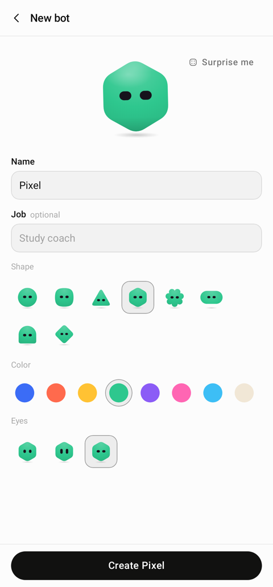

<p align="center">
  
</p>

<h1 align="center">gbot</h1>

<p align="center">Cute, persistent AI teammates that run entirely on your own machine.</p>

Each bot is a simple, expressive character with its own name, memory, one
continuous chat, and its own computer. Bots remember what you tell them,
show what they're doing through their eyes and motion (thinking, working,
needs you, stuck, done), and keep working while you keep chatting.

## Screenshots

| New bot | Chat and approvals | Group chat | Integrations |
|---|---|---|---|
|  |  |  |  |

- **Approvals and questions.** Bots ask before risky steps with a card in the
  chat (Ask, Auto or Never ask, plus allow/block lists). They ask you
  questions the same way. Cards never block the chat.
- **A queue that survives restarts.** Messages run in order; pause, resume
  or cancel any one. If the server restarts, what was waiting runs next
  instead of vanishing.
- **Memory that lasts.** Before a long chat outgrows the model, a rolling
  summary keeps the facts that matter, and a bot can search its own history
  for anything older.
- **A computer per bot.** A private Linux desktop (browser, terminal, files, and
  an Activity log of everything the bot runs) in its own microVM via
  [microsandbox](https://github.com/superradcompany/microsandbox), or a Docker
  container. No network unless you allow it. Watch it live beside the chat, or
  take control when it needs you (sign-ins, codes). **Sleep** freezes it with
  its windows and processes intact; **Wake** resumes them. It sleeps after 20
  idle minutes and wakes on its next use. This is a suspend, not a disk
  snapshot: microsandbox cannot full-snapshot a running desktop. Its browser
  can be limited to a site list, so internet
  access does not mean the whole internet.
- **Routines.** Prompts a bot runs on a schedule or when a webhook fires.
  Ask for one in chat, or set it up in the bot's panel.
- **Integrations.** One-click sign-in to 35 apps that publish an MCP server
  (Notion, Linear, Jira, Stripe, Figma, Datadog and more), custom MCP servers
  with tokens, and skills you write once and use anywhere with `/`. Tokens are
  encrypted at rest and scoped to your account.
- **Group chats.** Up to six bots in one chat. The first leads, `@mentions`
  bring others in, and bots hand work to each other.
- **Slack.** Mention a bot in a channel and it answers in the thread, with
  the same memory, tools and approvals it has in its own chat.
- **Voice.** Dictation and read-aloud, local by default.
- **Everywhere.** Web, a 4 MB desktop app (Tauri), and a native Android app
  (Kotlin + Compose) that also runs with no server at all.

- **Local first.** Defaults to models on your machine through
  [Ollama](https://ollama.com) or any OpenAI-compatible local server. No
  API keys, no accounts elsewhere, no telemetry. Cloud providers are optional,
  and each account can connect its own from Settings → Providers.
- **Built on [kritrim](https://github.com/ganeshdipdumbare/kritrim).** One
  small agent runtime with the secure default policy: Postgres-backed threads
  and memory, retries, limits, context trimming, and per-account model keys.
- **Fast.** One Go binary serves the API, live updates (SSE) and the
  precompressed web app (about 130 KB of JS, brotli).
- **Secure by default.** argon2id passwords, hashed session tokens,
  CSRF and origin checks, strict CSP, rate limits, and spaces as the
  authorization boundary on every query.

## Run it

You need Docker (for Postgres), Go 1.27+, Node 24 with pnpm, and Ollama with
the small Omni model, which handles tools and images:

```bash
ollama pull lfm3-omni
```

Other local models can be much larger than a laptop can hold; gbot picks
`lfm3-omni` by default when you have not chosen a model.

gbot uses [kritrim](https://github.com/ganeshdipdumbare/kritrim), a Go module that `go mod download` fetches.

Build the bots' computer image once (optional, about 1 GB, shared by every
bot). For lightweight microVM computers (boot in under a second, about 75 MB
of memory at idle), install microsandbox first; `make computer` loads the
image into it:

```bash
brew install superradcompany/tap/microsandbox
```

```bash
make computer
```

Then build and start everything:

```bash
make run
```

Open http://127.0.0.1:8080 and hatch your first bot.

For development with hot reload, run `make dev` and open http://127.0.0.1:5173.

### Model providers

Settings → Providers connects a model source to your account:

- **OpenAI-compatible** — vLLM, LM Studio, llama.cpp, LiteLLM, OpenRouter,
  or any server exposing `/v1/chat/completions`.
- **Anthropic** — Claude models.
- **Gemini** — Google AI Studio models.
- **Codex login** — OpenAI models through the ChatGPT account the Codex CLI
  is signed in to on the server (`codex login`). No API key; gbot reads
  Codex's own `auth.json` and saves refreshed tokens back. Because it spends
  the server owner's subscription, only accounts listed in
  `GBOT_CODEX_USERS` can add it.

Models are discovered from the provider's model list endpoint; if that is
unavailable, type model names manually (one per line). API keys are encrypted
at rest, never returned by the API, and scoped to your account: other accounts
cannot see or select your provider's models. `OLLAMA_HOST` and the API-key
environment variables below remain server-wide defaults.

### Slack

A bot can answer in a Slack channel. gbot does not host a Slack app, so you
create one in your own workspace and paste its two secrets into
Settings -> Slack; both are encrypted with the server key and never come
back out of the API.

1. Create a Slack app, add the `chat:write` bot scope and install it.
2. Under Event Subscriptions, set the Request URL to
   `$GBOT_PUBLIC_URL/slack/events` and subscribe to `app_mention`.
3. In Settings -> Slack, paste the workspace (team) ID, the `xoxb-` bot
   token and the signing secret, then link each channel to a bot.

Every inbound request is checked against the signing secret and refused if
it is more than five minutes old, so a captured one cannot be replayed.
A Slack message runs as the person who connected the workspace -- their
approvals, tools and memory apply -- and is marked untrusted, because the
text came from outside. Messages posted by any bot are ignored, so two
bots cannot talk to each other in circles.

This needs `GBOT_PUBLIC_URL`: Slack has to reach gbot over the internet, so
it does not work in the phone-only mode.

### Configuration

| Variable | Default | |
|---|---|---|
| `GBOT_DATABASE_URL` | local compose Postgres | Postgres connection string |
| `GBOT_ADDR` | `127.0.0.1:8080` | listen address |
| `OLLAMA_HOST` | `http://127.0.0.1:11434` | local model server |
| `GBOT_SIGNUP` | `open` | `closed` allows only the first account |
| `GBOT_CODEX_USERS` | | comma-separated emails allowed to use the server's Codex (ChatGPT) login |
| `GBOT_CODEX_HOME` | `$CODEX_HOME` or `~/.codex` | where Codex keeps its login |
| `GBOT_PUBLIC_URL` | | the `https://` address people open, e.g. `https://bots.example.com`. Required for integration sign-in from another device; also enables secure cookies and HSTS |
| `GBOT_COOKIE_SECURE` | from `GBOT_PUBLIC_URL` | `true` or `false`; set `false` when phones reach the same server over plain http on a LAN |
| `GBOT_COMPUTER` | `on` | `off` disables bot computers |
| `GBOT_COMPUTER_BACKEND` | auto | `microsandbox` or `docker`; auto prefers microsandbox when `msb` is installed |
| `GBOT_COMPUTER_IMAGE` | `gbot-computer:latest` | image for bot computers |
| `GBOT_MAX_STEPS` | `40` | model/tool rounds one run may take (and 4x that in tool calls) |
| `GBOT_RUN_TIMEOUT` | `30m` | wall-clock cap for one run, e.g. `45m` |
| `GBOT_CONTEXT_TOKENS` | `24000` | prompt budget before older turns are summarized |

| `GBOT_KEY_FILE` | `~/.config/gbot/secret.key` | key that encrypts integration tokens (or set `GBOT_SECRET_KEY`) |
| `GBOT_STT_URL`, `GBOT_TTS_URL` | | OpenAI-compatible speech servers (e.g. faster-whisper, Kokoro), or `openai` |
| `ANTHROPIC_API_KEY`, `OPENAI_API_KEY`, `GEMINI_API_KEY`, `DEEPSEEK_API_KEY`, `GROQ_API_KEY`, `OPENROUTER_API_KEY` | | optional cloud models |

## Layout

```
server/               Go: API, auth, store, agent runtime (kritrim), computers, routines
apps/web/             React 19 + Vite + Tailwind + Motion
apps/desktop/         Tauri 2 shell with native notifications
apps/android/         native Android app (Kotlin + Jetpack Compose)
packages/characters/  the gbot character rig: seeded traits, moods, animation
packages/ui-tokens/   design tokens shared by every surface
infra/compose/        Postgres (+ optional Ollama and app image)
infra/sandboxes/      the bots' computer image
```

## Tests

```bash
make test
```

The Go tests run the whole API against a throwaway database with
kritrim's offline mock model, so they need no network or keys.

## Desktop and mobile

```bash
make desktop   # builds apps/desktop/src-tauri/target/release/bundle/macos/gbot.app
make android   # builds apps/android/app/build/outputs/apk/release/app-release.apk
```

Both connect to your gbot server; the phone needs its address on your network.
The Android app is native (Kotlin + Jetpack Compose) and has
everything the web app has. It keeps a quiet connection to your server in
the background, so you get alerts when a bot needs you or finishes, with
Approve and Decline right on the notification, without Google's push
service. On iPhone, open the web app in Safari and use Add to Home Screen.

It also behaves like an Android app rather than a page: share text or a link
from any app to send it to a bot (it lands in the message box, so nothing is
sent by accident), long-press the launcher icon for your pinned and most
recent bots, open a chat with `gbot://chat/<id>`, and pick light, dark or
your phone's setting in Settings → Appearance.

### On the phone alone

The Android app can also run with no server at all: choose **Use a model on
this phone** on the first screen. The model, the chat, memory and the bot's
browser then stay on the phone (Settings → Connect my server switches back).
Connect OpenAI, Anthropic, Gemini or any OpenAI-compatible provider in
Settings → Models if you want a bigger brain for hard pages; its models are
discovered when you save it, and a bot uses them without any phone model.
Keys stay in the app's private storage. A phone model (Gemma 4 E4B, 3.7 GB, or
E2B, 2.6 GB) is optional and makes replies work offline.

A bot on the phone gets a real browser window instead of a Linux desktop: a
Chromium WebView it reads, clicks and fills through the DOM. It acts on
numbered elements from `browser_read`, and asks first for anything that changes
something (`browser_click`, `browser_fill`, `open_in_chrome`) unless you allow
the tool. It is shown as the bot's computer — a small screen with the same
window, expandable to full size — so taking over is just touching the page.
`open_in_chrome` hands a page to your real browser when a site needs your
session there. Settings → About you holds the details it fills into forms.

The rest of the app is here too. Group chats work the same way: @mentioned bots
answer, otherwise the first bot leads, and a reply can hand work to a teammate
by @mentioning them. Routines use the same 5-field cron and presets as the
server, can be created from chat, and run while gbot is open (a missed time
catches up later). Integrations speak MCP over HTTP — servers that need
sign-in (OAuth) still need your gbot server; add one with a token instead.
Skills load with `use_skill`, the vault types saved secrets into fields on the
sites they were saved for without showing the value to the model, and every
provider, notification and voice feature works. Team sharing and spaces stay
server features, because they exist to share between people.

Phone limits worth knowing: the model download is 2–4 GB and the largest wants
8 GB of RAM; the first load and a long prompt take seconds; one reply runs at
a time (the rest wait in the chat queue); the browser has its own cookie jar
(not Chrome's, so sign in inside gbot's window), some sites block WebViews,
downloads are not handled yet, and routines do not run while gbot is closed.
The model is unloaded after two idle minutes (or when gbot goes to the
background), so it isn't holding RAM while you're away — change that window in
Settings → Models, where each downloaded model can also be removed.

## Security notes

- Bots run one tool call at a time through a guard that applies the owner's
  approval mode and allow/block lists. Once outside text (a webhook, a web page,
  an MCP result) enters a run, changes always ask first, even in Auto.
- Computers are hardware-isolated microVMs (or containers with all capabilities
  dropped and no new privileges), with CPU/memory limits and no network by
  default. gbot reaches them only by running commands inside them.
  Takeover input is accepted only while you hold control.
- A bot's browser allowlist checks the pages it visits, with subdomains
  included. Ads, CDNs and page assets are not checked; shell commands still
  use the network when a bot's internet is on.
- Webhooks need the routine's secret (bearer token or HMAC signature).
- MCP tokens are sealed with AES-256-GCM and redacted from logs; each account
  only ever sees its own servers' tools. Integration sign-in sends the browser
  back to `GBOT_PUBLIC_URL` when set, so a server behind a tunnel or on another
  device works; without it, the browser's own origin is used.
